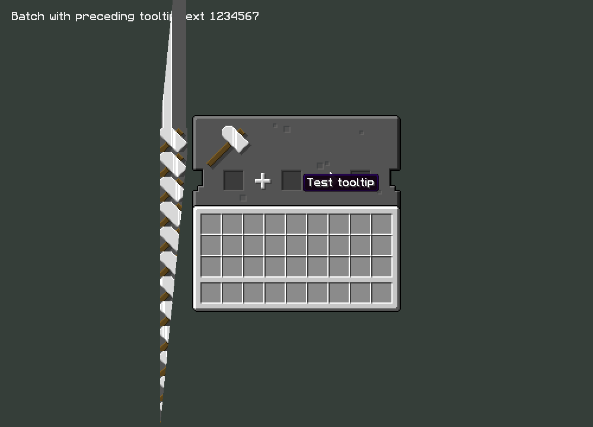
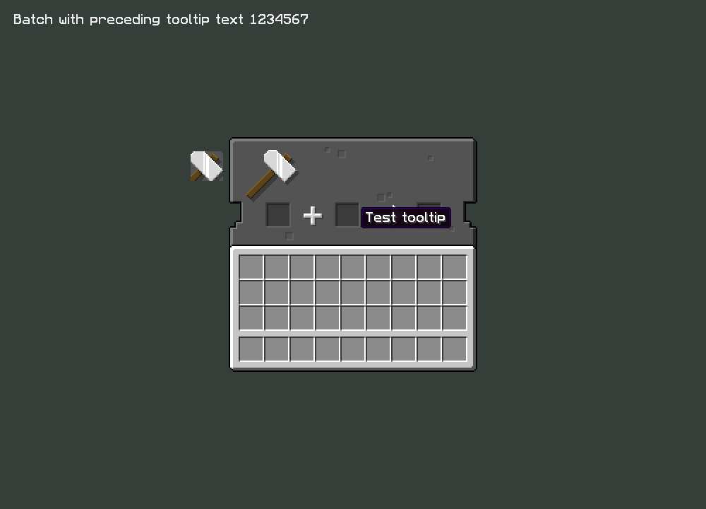
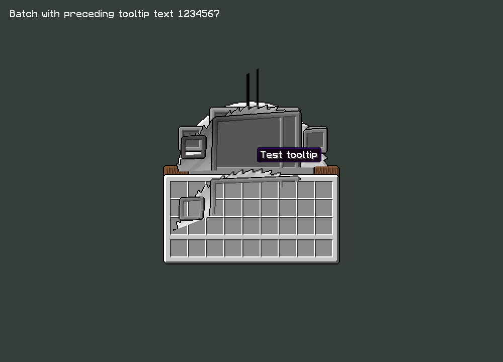
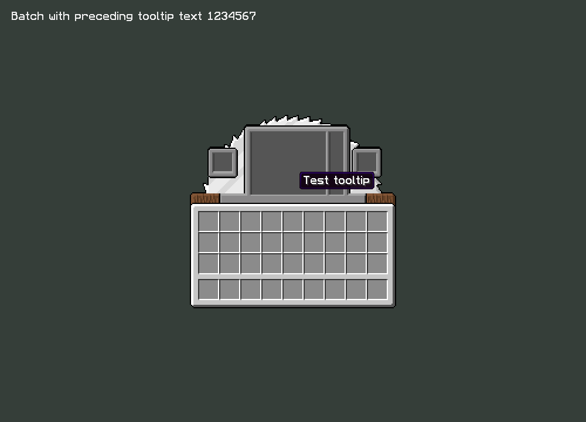
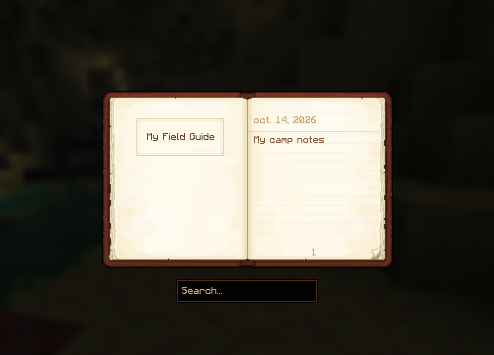

# Compatibility validation — 2026.10.14.1

The Recolourful correction is in the shared 26.2 text shader. All 68 bitmap UI textures using encoded corner markers were audited: each has four valid red-channel markers. Native probes rendered all 68 cases with and without preceding text/tooltip batching (136 captures). This covers the 11 workstation animation elements and barrel, Ender Chest, horse, minecart, boat, shulker and villager metadata/overlay variants. Metadata glyphs intentionally hidden outside their corresponding screen are covered by the marker audit; their full gameplay menus were not individually opened. The same shader correction applies to all these providers. GUI sprites using the separate position texture shader already enable the red-channel path and are unchanged.

The three reported screens reproduced repeating/triangular strips before the correction and removed them afterward. Enchanting, cartography, dropper/dispenser and smithing animation probes also render without those strips. Artwork, animation timing and every other pack archive entry are unchanged. This validates the identified corner-selection bug, not every possible UI problem.

| Anvil before | Anvil after |
| --- | --- |
|  |  |

| Stonecutter before | Stonecutter after |
| --- | --- |
|  |  |

Field Guide's native Scholar journal accepts keyboard input, saves locally on unsupported servers and retains notes after world unload/load and reopening. Notes are scoped to the player and server and excluded from sharing. Server-supported discovery and journal synchronization retain the original code path.

There are 22 sound-dispatch/journal-store assertions. Full and protected pack native startup, resource-pack order and fieldbook render/navigation pass with all 33/31 chosen packs. The standalone launcher and a clean build of this repository's source compile successfully. Interactive Stuff's captured sound-thread world access is redirected to Minecraft's thread; a sculk-sensor gameplay confirmation remains pending. Shutdown-watchdog reports are not attributed to this fix without further evidence.
